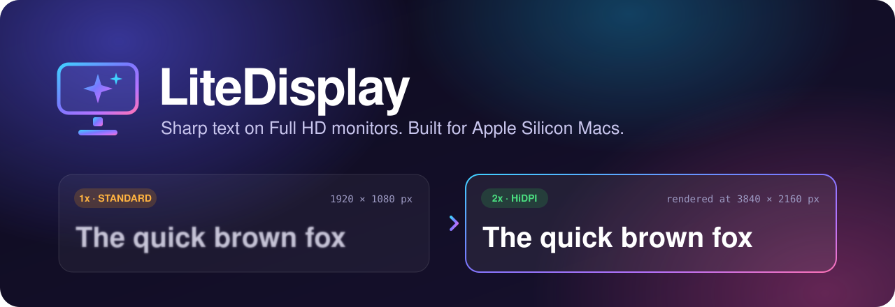
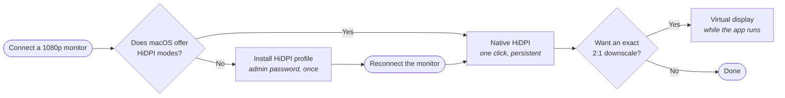

<p align="center">
  
</p>

<p align="center">
  <a href="#install"></a>
  
  
  
  
  <a href="LICENSE"></a>
</p>

<p align="center">
  <b>English</b> · <a href="README.pt-BR.md">Português (Brasil)</a>
</p>

---

**LiteDisplay makes a 1080p external monitor look sharp on a Mac.** It is a small native menu-bar app that puts
your non-Retina display into a HiDPI (2x) mode, so macOS draws text with four times the pixels and scales it down
to the panel — at your monitor's full refresh rate, up to 240 Hz.

No kernel extension, no background helper, no network access, no account. Source included.

## The problem

Plug a 1920×1080 monitor into a Mac and text looks thin and jagged. Two things cause it:

- macOS treats the panel as a **1x** display, so every glyph is drawn with the bare minimum of pixels.
- Since macOS Mojave there is **no subpixel antialiasing** to compensate on non-Retina screens.

macOS only offers the crisp "looks like" scaled modes on displays it considers high-density, so System Settings
gives you no way out. LiteDisplay does.

## How LiteDisplay fixes it

Three methods, chosen per monitor. The app picks the recommended one and shows the others for comparison.

| Method | What it does | Survives quitting the app | Best for |
|---|---|:---:|---|
| **Native HiDPI** | Switches the panel to a HiDPI mode it (or an installed profile) already offers — for example "looks like 1904×1071", rendered at 3808×2142. Keeps the refresh rate. | Yes | Everyday use. The default. |
| **HiDPI profile** | When macOS offers no HiDPI modes for the panel, generates a display override and installs it into `/Library/Displays` (asks for the administrator password once; reconnect the monitor afterwards). | Yes | One-time setup per monitor. |
| **Virtual display** | Creates a 2x virtual display (e.g. 3840×2160) and mirrors the panel onto it: an exact 2:1 downscale, the sharpest result a 1080p panel can show. | No — undone on quit | Maximum sharpness, or when a profile is not possible. |



## Features

- **Sharpness per monitor** — Standard (1x), Native HiDPI or Virtual display, switchable in one click from the
  window or the menu bar.
- **Curated interface sizes** — More space, Standard, Larger, Much larger, Huge. Everything stays sharp; only the
  amount of screen space changes.
- **Refresh rate control** — every rate the panel reports for the chosen size, including 120/144/240 Hz.
- **Full mode table** — every mode macOS reports for the display, filterable, with the current one marked.
- **Profiles** — save a setup ("Work", "Games", "Movies"), apply it in one click, and optionally apply it
  automatically when the monitor connects.
- **Eye comfort** — a blue light filter by colour temperature (2700 K – 6500 K), per monitor or on all displays,
  all day or on a schedule that can cross midnight. Does not touch brightness; restored when the app quits.
- **Stronger font smoothing**, **open at login**, and **automatic restore** after reconnecting or waking from sleep.
- **Bilingual UI** — Portuguese (Brazil) and English.
- **Native and light** — SwiftUI, system fonts, SF Symbols, Liquid Glass where available. Zero third-party
  dependencies.

> [!NOTE]
> Screenshots are coming. If you run LiteDisplay on your setup, a screenshot in a
> [compatibility report](../../issues/new?template=compatibility_report.yml) is very welcome.

## Install

**Requirements:** macOS 15 or later, an Apple Silicon Mac, and Xcode (the project is generated for Xcode 26).

There are no prebuilt downloads yet, so LiteDisplay is built from source. It takes about a minute:

```bash
brew install xcodegen swiftlint swiftformat
```

```bash
git clone https://github.com/renatoasterio/LiteDisplay.git && cd LiteDisplay
```

```bash
make install
```

`make install` builds the app and copies it to `/Applications`, a stable path that "Open at login" needs.
Use `make run` instead to build and launch without installing.

The app is ad-hoc signed and not notarized. If macOS blocks the first launch, right-click the app and choose
**Open**, or allow it in **System Settings › Privacy & Security**.

## Quick start

1. Open LiteDisplay and select your external monitor in the sidebar.
2. Under **Sharpness**, choose **Native HiDPI**. If it is unavailable, click **Enable HiDPI on this display…**,
   enter your password, then unplug and reconnect the monitor.
3. Pick an **Interface size** and a **Refresh rate**.
4. Optional: try **Virtual display** and compare. Save what you like as a **Profile**.

Native HiDPI is written to the display configuration, so it stays on after you quit the app. Enable
**Open at login** if you use the virtual display or the blue light filter, which only last while the app runs.

## Privacy and security

LiteDisplay changes system display settings, so it is built to be easy to audit.

- **No networking, no telemetry, no dynamic code loading.** Nothing leaves your Mac.
- **No persistent privileged helper and no `sudo`.** Administrator rights are requested through the standard macOS
  password prompt, only when you click to install a HiDPI profile, never at launch.
- **One auditable privileged path.** A single file,
  [`PrivilegedRunner.swift`](LiteDisplay/Infrastructure/Override/PrivilegedRunner.swift), spawns a process.
  Commands are built from constants and shell-quoted paths, and the installed profile is read back and compared
  byte for byte.
- **Reversible.** Display changes go through CoreGraphics configuration transactions and are verified after they
  complete; gamma tables are cached before the first change and restored on quit.
- **Hardened runtime**, typed errors with recovery suggestions, private logging for paths and display names.

Found a vulnerability? See [SECURITY.md](SECURITY.md).

## FAQ

<details>
<summary><b>Will this make my 1080p monitor look like a Retina display?</b></summary>

No. The panel still has 1920×1080 physical pixels. What changes is how macOS renders: text is drawn at 2x and
downsampled, which gives smoother, heavier glyphs and far less jaggedness. Most people find it a clear improvement;
how much depends on the panel's pixel density and your viewing distance.
</details>

<details>
<summary><b>What is the difference between Native HiDPI and the virtual display?</b></summary>

Native HiDPI uses a real mode of your panel and persists without the app. On a 1080p panel the largest usable HiDPI
size is typically 1904×1071, a slightly non-integer downscale. The virtual display renders at exactly 2× the panel
(3840×2160 → 1920×1080), which is the sharpest possible result, but it only lasts while LiteDisplay is running.
</details>

<details>
<summary><b>Does it lower my refresh rate?</b></summary>

No. Both methods keep the panel's refresh rate. LiteDisplay has been verified at 240 Hz with both.
</details>

<details>
<summary><b>Why does the app relaunch when I turn the virtual display off?</b></summary>

macOS only removes a virtual display once the process that created it exits. LiteDisplay relaunches itself (about
two seconds) so no phantom display is left behind.
</details>

<details>
<summary><b>Does it use private APIs?</b></summary>

One. The virtual display uses `CGVirtualDisplay`, a private CoreGraphics API, isolated in
[`Infrastructure/VirtualDisplay`](LiteDisplay/Infrastructure/VirtualDisplay) and guarded at runtime. Native HiDPI,
profiles and the blue light filter use public APIs only. This is also why LiteDisplay is not on the Mac App Store.
</details>

<details>
<summary><b>How do I undo everything?</b></summary>

Choose **Standard (1x)** to return the panel to its native mode. To remove an installed HiDPI profile, delete its
file under `/Library/Displays/Contents/Resources/Overrides/` and reconnect the monitor.
</details>

<details>
<summary><b>Does it work with 1440p, ultrawide or Intel Macs?</b></summary>

It is designed and tested for 1080p panels on Apple Silicon. Other resolutions may work and reports are welcome.
Intel Macs are not supported.
</details>

## Tested hardware

| Monitor | Panel | Mac | Native HiDPI | Virtual display |
|---|---|---|:---:|:---:|
| Acer Predator XB273 GX | 27″ 1920×1080, 240 Hz | MacBook Pro (M2 Pro) | ✅ 1904×1071 @ 240 Hz | ✅ exact 2:1 @ 240 Hz |

Running it on something else? **[Add your monitor](../../issues/new?template=compatibility_report.yml)** — every
report helps the next person know what to expect.

## Diagnostics

```bash
make modes
```

lists every display and every mode, with the current one marked.

```bash
scripts/verify-override.sh 472 746
```

validates an installed HiDPI profile (vendor and product ids in hex).

## For developers

LiteDisplay follows a layered architecture — `Features → Domain ← Infrastructure` — with a Foundation-only
domain, protocol-based services and unit tests that swap Infrastructure for fakes.

```bash
make build   # Debug build (outside the repository)
make test    # Swift Testing suites
make lint    # swiftlint --strict + swiftformat --lint
make audit   # lint, static analyzer and safety scans
```

- [Architecture](docs/ARCHITECTURE.md) — layers, how each sharpness method works, threading model, verification.
- [Contributing](CONTRIBUTING.md) — setup, rules and how to send a change.
- [Changelog](CHANGELOG.md)

## Contributing

Bug reports, compatibility reports, translations and pull requests are welcome. Start with
[CONTRIBUTING.md](CONTRIBUTING.md), and please follow the [Code of Conduct](CODE_OF_CONDUCT.md).

If LiteDisplay made your monitor easier on the eyes, a ⭐ helps other people find it.

## Acknowledgements

The HiDPI profile format follows the display override layout popularised by the
[one-key-hidpi](https://github.com/xzhih/one-key-hidpi) project.

## License

[PolyForm Noncommercial License 1.0.0](LICENSE) © Renato Asterio. Free to use, modify and share for noncommercial
purposes. The source is public, but this is not an OSI-approved open source license: commercial use requires a
separate agreement.
