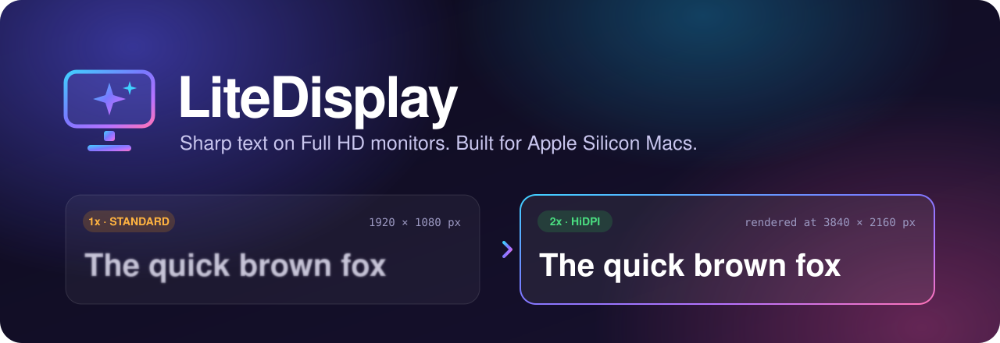
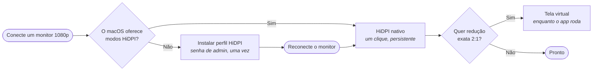

<p align="center">
  
</p>

<p align="center">
  <a href="#instalação"></a>
  
  
  
  
  <a href="LICENSE"></a>
</p>

<p align="center">
  <a href="README.md">English</a> · <b>Português (Brasil)</b>
</p>

---

**O LiteDisplay deixa um monitor externo 1080p nítido no Mac.** É um app nativo e leve, na barra de menus, que
coloca a sua tela não-Retina em um modo HiDPI (2x): o macOS desenha o texto com quatro vezes mais pixels e reduz
para o painel — na taxa de atualização máxima do monitor, até 240 Hz.

Sem extensão de kernel, sem helper em segundo plano, sem acesso à rede, sem conta. Código incluído.

## O problema

Conecte um monitor 1920×1080 a um Mac e o texto fica fino e serrilhado. Dois motivos:

- O macOS trata o painel como tela **1x**, então cada letra é desenhada com o mínimo de pixels.
- Desde o macOS Mojave **não existe antialiasing subpixel** para compensar em telas não-Retina.

O macOS só oferece os modos escalados nítidos ("parece …") em telas que ele considera de alta densidade, então os
Ajustes do Sistema não dão saída. O LiteDisplay dá.

## Como o LiteDisplay resolve

Três métodos, escolhidos por monitor. O app indica o recomendado e mostra os outros para comparação.

| Método | O que faz | Continua após sair do app | Ideal para |
|---|---|:---:|---|
| **HiDPI nativo** | Troca o painel para um modo HiDPI que ele (ou um perfil instalado) já oferece — por exemplo "parece 1904×1071", desenhado em 3808×2142. Mantém a taxa de atualização. | Sim | Uso diário. É o padrão. |
| **Perfil HiDPI** | Quando o macOS não oferece modos HiDPI para o painel, gera um override de tela e instala em `/Library/Displays` (pede a senha de administrador uma vez; reconecte o monitor depois). | Sim | Configuração única por monitor. |
| **Tela virtual** | Cria uma tela virtual 2x (ex.: 3840×2160) e espelha o painel nela: redução exata 2:1, o resultado mais nítido que um painel 1080p consegue mostrar. | Não — desfeito ao sair | Nitidez máxima, ou quando o perfil não é possível. |



## Recursos

- **Nitidez por monitor** — Padrão (1x), HiDPI nativo ou Tela virtual, com um clique na janela ou na barra de menus.
- **Tamanhos de interface curados** — Mais espaço, Padrão, Maior, Muito maior, Enorme. Tudo continua nítido; muda
  só o espaço na tela.
- **Taxa de atualização** — todas as taxas que o painel informa para o tamanho escolhido, incluindo 120/144/240 Hz.
- **Tabela completa de modos** — todos os modos que o macOS informa, com filtro e o modo atual marcado.
- **Perfis** — salve uma configuração ("Trabalho", "Jogos", "Filmes"), aplique com um clique e, se quiser,
  automaticamente ao conectar o monitor.
- **Conforto visual** — filtro de luz azul por temperatura de cor (2700 K – 6500 K), por monitor ou em todas as
  telas, o dia todo ou em um horário que pode atravessar a meia-noite. Não mexe no brilho; é restaurado ao sair.
- **Suavização de fontes mais forte**, **iniciar no login** e **restauração automática** ao reconectar ou acordar.
- **Interface bilíngue** — português (Brasil) e inglês.
- **Nativo e leve** — SwiftUI, fontes do sistema, SF Symbols, Liquid Glass quando disponível. Zero dependências de
  terceiros.

> [!NOTE]
> As capturas de tela estão a caminho. Se você usa o LiteDisplay, uma captura em um
> [relato de compatibilidade](../../issues/new?template=compatibility_report.yml) é muito bem-vinda.

## Instalação

**Requisitos:** macOS 15 ou mais recente e Mac com Apple Silicon.

### Download

1. Baixe o `LiteDisplay-<versão>.zip` na
   **[versão mais recente](https://github.com/renatoasterio/LiteDisplay/releases/latest)** e descompacte.
2. Mova o `LiteDisplay.app` para `/Applications`.
3. Abra o app. O LiteDisplay é assinado ad-hoc e não é notarizado, então o macOS bloqueia a primeira abertura: vá em
   **Ajustes do Sistema › Privacidade e Segurança**, role até o aviso sobre o LiteDisplay e clique em
   **Abrir Mesmo Assim**.

Se preferir o terminal, remover a marca de quarentena tem o mesmo efeito:

```bash
xattr -dr com.apple.quarantine /Applications/LiteDisplay.app
```

Cada versão informa o SHA-256 do arquivo, para você conferir o download com `shasum -a 256`.

### Compilar a partir do código

Precisa do Xcode (o projeto é gerado para o Xcode 26). Leva cerca de um minuto:

```bash
brew install xcodegen swiftlint swiftformat
```

```bash
git clone https://github.com/renatoasterio/LiteDisplay.git && cd LiteDisplay
```

```bash
make install
```

O `make install` compila o app e copia para `/Applications`, caminho estável que o "Iniciar no login" exige.
Use `make run` para compilar e abrir sem instalar.

## Primeiros passos

1. Abra o LiteDisplay e selecione o monitor externo na barra lateral.
2. Em **Nitidez**, escolha **HiDPI nativo**. Se estiver indisponível, clique em **Habilitar HiDPI neste monitor…**,
   informe a senha e depois desconecte e reconecte o monitor.
3. Escolha o **Tamanho da interface** e a **Taxa de atualização**.
4. Opcional: experimente a **Tela virtual** e compare. Salve o que gostar como **Perfil**.

O HiDPI nativo é gravado na configuração da tela, então continua ativo depois de sair do app. Ative
**Iniciar no login** se usar a tela virtual ou o filtro de luz azul, que só valem enquanto o app está aberto.

## Privacidade e segurança

O LiteDisplay altera ajustes de tela do sistema, por isso foi feito para ser fácil de auditar.

- **Sem rede, sem telemetria, sem carregamento dinâmico de código.** Nada sai do seu Mac.
- **Sem helper privilegiado persistente e sem `sudo`.** O acesso de administrador é pedido pelo diálogo padrão de
  senha do macOS, só quando você clica para instalar um perfil HiDPI, nunca na abertura.
- **Um único caminho privilegiado, auditável.** Um só arquivo,
  [`PrivilegedRunner.swift`](LiteDisplay/Infrastructure/Override/PrivilegedRunner.swift), inicia um processo. Os
  comandos são montados a partir de constantes e caminhos com aspas de shell, e o perfil instalado é lido de volta
  e comparado byte a byte.
- **Reversível.** As mudanças de tela passam por transações de configuração do CoreGraphics e são verificadas ao
  final; as tabelas de gama são guardadas antes da primeira mudança e restauradas ao sair.
- **Hardened runtime**, erros tipados com sugestão de recuperação, log privado para caminhos e nomes de monitores.

Encontrou uma vulnerabilidade? Veja [SECURITY.md](SECURITY.md).

## Perguntas frequentes

<details>
<summary><b>Meu monitor 1080p vai ficar igual a uma tela Retina?</b></summary>

Não. O painel continua com 1920×1080 pixels físicos. O que muda é como o macOS desenha: o texto é renderizado em 2x
e reduzido, o que deixa as letras mais suaves, mais encorpadas e bem menos serrilhadas. A maioria das pessoas
percebe uma melhora clara; o quanto depende da densidade do painel e da distância de uso.
</details>

<details>
<summary><b>Qual a diferença entre HiDPI nativo e tela virtual?</b></summary>

O HiDPI nativo usa um modo real do painel e persiste sem o app. Em um painel 1080p o maior tamanho HiDPI utilizável
costuma ser 1904×1071, uma redução levemente não inteira. A tela virtual desenha em exatamente 2× o painel
(3840×2160 → 1920×1080), o resultado mais nítido possível, mas só vale enquanto o LiteDisplay está aberto.
</details>

<details>
<summary><b>A taxa de atualização diminui?</b></summary>

Não. Os dois métodos mantêm a taxa de atualização do painel. O LiteDisplay foi verificado a 240 Hz com ambos.
</details>

<details>
<summary><b>Por que o app reabre quando desligo a tela virtual?</b></summary>

O macOS só remove uma tela virtual quando o processo que a criou termina. O LiteDisplay se reabre sozinho (cerca de
dois segundos) para não deixar uma tela fantasma.
</details>

<details>
<summary><b>Ele usa APIs privadas?</b></summary>

Uma. A tela virtual usa `CGVirtualDisplay`, API privada do CoreGraphics, isolada em
[`Infrastructure/VirtualDisplay`](LiteDisplay/Infrastructure/VirtualDisplay) e protegida por verificação em tempo
de execução. HiDPI nativo, perfis e filtro de luz azul usam só APIs públicas. Por isso também o LiteDisplay não
está na Mac App Store.
</details>

<details>
<summary><b>Como desfaço tudo?</b></summary>

Escolha **Padrão (1x)** para voltar o painel ao modo nativo. Para remover um perfil HiDPI instalado, apague o
arquivo dele em `/Library/Displays/Contents/Resources/Overrides/` e reconecte o monitor.
</details>

<details>
<summary><b>Funciona com 1440p, ultrawide ou Macs Intel?</b></summary>

Foi projetado e testado para painéis 1080p em Apple Silicon. Outras resoluções podem funcionar e relatos são
bem-vindos. Macs Intel não são suportados.
</details>

## Hardware testado

| Monitor | Painel | Mac | HiDPI nativo | Tela virtual |
|---|---|---|:---:|:---:|
| Acer Predator XB273 GX | 27″ 1920×1080, 240 Hz | MacBook Pro (M2 Pro) | ✅ 1904×1071 @ 240 Hz | ✅ 2:1 exato @ 240 Hz |

Usa em outro equipamento? **[Adicione o seu monitor](../../issues/new?template=compatibility_report.yml)** — cada
relato ajuda a próxima pessoa a saber o que esperar.

## Diagnóstico

```bash
make modes
```

lista todas as telas e todos os modos, com o atual marcado.

```bash
scripts/verify-override.sh 472 746
```

valida um perfil HiDPI instalado (ids de fabricante e produto em hexadecimal).

## Para desenvolvedores

O LiteDisplay segue uma arquitetura em camadas — `Features → Domain ← Infrastructure` — com domínio que importa só
`Foundation`, serviços baseados em protocolos e testes unitários que trocam a Infrastructure por fakes.

```bash
make build   # build Debug (fora do repositório)
make test    # suítes Swift Testing
make lint    # swiftlint --strict + swiftformat --lint
make audit   # lint, analisador estático e verificações de segurança
```

- [Arquitetura](docs/ARCHITECTURE.md) — camadas, como cada método funciona, modelo de threads, verificação (em inglês).
- [Como contribuir](CONTRIBUTING.md) — ambiente, regras e como enviar uma mudança (em inglês).
- [Changelog](CHANGELOG.md)

## Contribuindo

Relatos de bugs, relatos de compatibilidade, traduções e pull requests são bem-vindos. Comece pelo
[CONTRIBUTING.md](CONTRIBUTING.md) e siga o [Código de Conduta](CODE_OF_CONDUCT.md). Issues em português são
bem-vindas.

Se o LiteDisplay deixou o seu monitor mais confortável, uma ⭐ ajuda outras pessoas a encontrar o projeto.

## Agradecimentos

O formato do perfil HiDPI segue o layout de override de tela popularizado pelo projeto
[one-key-hidpi](https://github.com/xzhih/one-key-hidpi).

## Licença

[PolyForm Noncommercial License 1.0.0](LICENSE) © Renato Asterio. Livre para usar, modificar e compartilhar para
fins não comerciais. O código é público, mas esta não é uma licença open source aprovada pela OSI: uso comercial
exige um acordo à parte.
